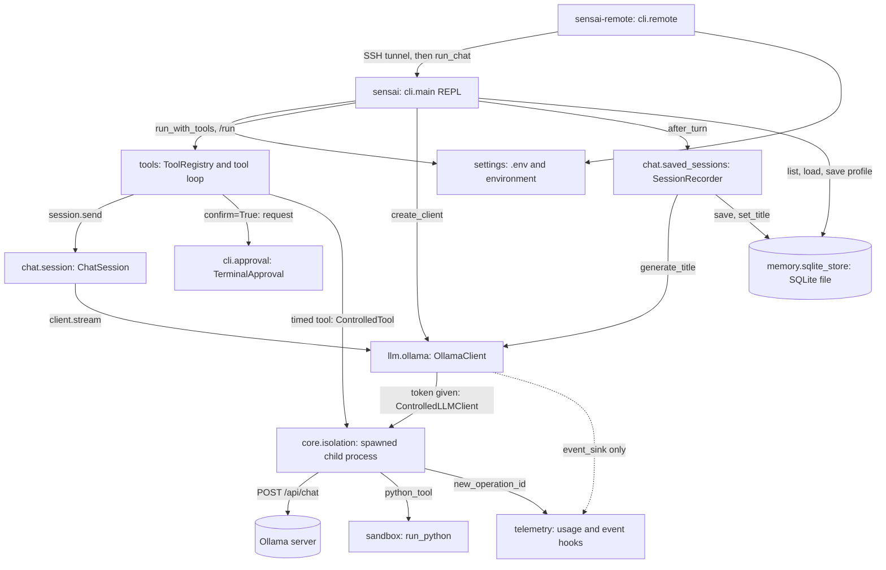
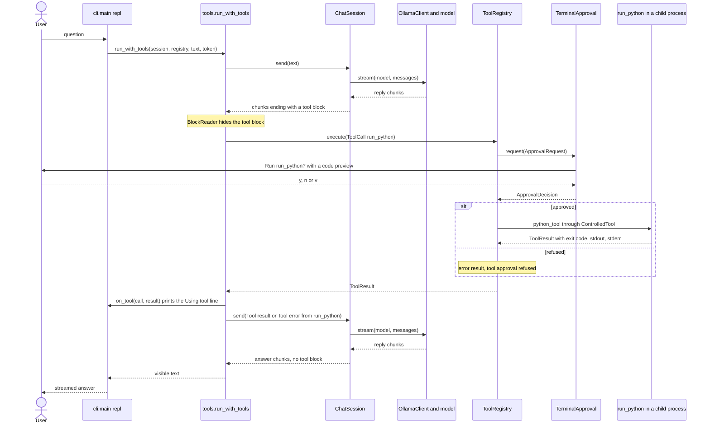

# Architecture overview

The base chat (B1 in the subject catalogue) is the CLI → `ChatSession` →
`LLMClient` → `OllamaClient` stream. `Message` is the frozen, role-tagged
wire/history value. `ChatSession` holds **in-memory** history, starts with one
system message, and sends a copy of the full conversation on every turn. The
CLI chooses the model via argument/configuration. The subject requires
incremental CLI output, in-session history, and clean empty-input/model/
connection errors; it does **not** require any optional feature in the base
chat. Keep this path working without feature adapters.

The CLI also implements two optional features on top of it:

- **Personas** (`sensai.chat.personas`): the shared prompt plus a selected
  persona block forms the system message; `/persona <id>` replaces it between
  turns while keeping completed exchanges. See
  [the persona guide](../product/personas.md).
- **Saved sessions and creator profile** (`sensai.chat.saved_sessions` and
  `sensai.memory.sqlite_store`): completed turns are saved to SQLite and can be
  resumed; a stored creator profile is injected into the system message. See
  [storage.md](storage.md).

## Module layout and dependencies

| Package | Responsibility |
| --- | --- |
| `sensai.cli` | Entry points: `main` (`sensai`: arguments, REPL), `remote` (`sensai-remote`: SSH tunnel), `terminal` (POSIX input with cancel keys) |
| `sensai.chat` | Chat session history, personas, system prompt (packaged `system_prompt.txt`), saved-session recording (`saved_sessions`) |
| `sensai.settings` | Configuration from the environment and `.env` |
| `sensai.core` | Messages, errors, cancellation token, typed ports (`ports.py`), process isolation (`isolation.py`), declarative policy types |
| `sensai.llm` | Ollama HTTP clients: streaming chat, embeddings, structured (JSON-schema) replies |
| `sensai.memory` | SQLite storage (`sqlite_store`) and the in-memory vector index |
| `sensai.telemetry` | Optional usage and privacy-safe event hooks |

`sensai.core` and `sensai.llm` do not import `sensai.chat`, `sensai.cli` or
`sensai.settings` at runtime
(`ChatSessionAdapter` refers to `ChatSession` and `create_client` to
`Settings` only for type checking). `core.isolation` uses `llm.client`/`llm.ollama_api`, and
`llm.ollama` imports `core.isolation` lazily when a cancellation token is
passed; that runtime link is intentional.

This is how the modules call each other when `sensai` or `sensai-remote` runs
(the dotted arrow is not used by the CLI, which sets no event sink):



## Data flow and extension points

```text
CLI input
  → optional input guardrail → session.send(text)
  → [optional consented profile/facts and retrieval context assembled by caller]
  → ChatSession → LLMStreamPort (OllamaClient) → model chunks
  → optional output guardrail → CLI stream
  → on complete turn only: SessionStorePort.save (CLI session recorder), optional EventPort.emit

optional tool request → PermissionPort.check → ApprovalPort.request if needed
                      → ToolPort.execute → optional EventPort.emit
```

Guardrails, retrieval context, tools, permissions, approvals and events are
**extension points**, not implemented features. A caller may compose
`ChatSessionAdapter` around `ChatSession` for a read-only history snapshot and
propagation of cancellation/deadlines. Never call `save` from inside a
partially consumed generator: full exhaustion is the success boundary.
Storage, embeddings, retrieval, tools, policy, and events must be
independently injected behind the small protocols in
[`ports.md`](ports.md). No dependency on `policy.py` is
required to implement these ports.

| Area | Owns | Consumes / returns |
| --- | --- | --- |
| Base chat | Typed seams, base-chat adapter, fake harness | `Message`, `LLMStreamPort`, `ConversationPort`, `SessionSnapshot` |
| Personas, sessions, profiles, facts | Persona selection, persistence, consent, deletion | `PersonaPort`, `SessionStorePort`, `ProfileStorePort`, `FactStorePort`; the CLI saves completed turns only |
| Retrieval | Local ingestion/search, source relevance | `EmbeddingPort`, `RetrievalPort` → attributed `RetrievedChunk`; caller decides what enters model context |
| Tools | Execution and resource isolation | `ToolCall` → `ToolResult` **after** permission and any required approval, never as an implicit model side effect |
| Policy | Rules, scope, consent/approval UX, input/output guardrails | `PermissionPort`, `ApprovalPort`, `GuardrailPort` with typed decisions; deny by default when no applicable authorization |
| Observability and evaluation | Safe event consumers | `EventPort` metadata; no automatic prompt/response logging |

## One turn with a tool call

This is one question in the CLI where the model asks for `run_python`, a
`confirm=True` tool, and then answers with its result:



## Error, cancellation, privacy invariants

- The base chat preserves the `LLMError` hierarchy and empty-input validation.
  `ChatSession` removes all incomplete turns on errors, cancellation, timeout
  or early close; only successful exhaustion commits an assistant reply.
  Feature failures remain `PortError`, with `PolicyDenied` for denied policy
  decisions.
- `OperationCancelled` and `OperationTimedOut` are distinct. The same optional
  token travels through adapters without resetting its monotonic deadline.
  Token-bearing Ollama calls run in an interruptible process group, which is
  stopped and reaped on abandonment. Previously displayed text is retained;
  partial turns must not be persisted. See [cancellation.md](cancellation.md).
- Ollama defaults to a local URL, but host configuration can point elsewhere;
  *never assume every configured backend is local*. Treat prompts, transcripts,
  facts, profile fields, retrieved text, and tool args/results as private. Do
  not send them to tools/network or include them in events without explicit
  authorization. Policy checks must occur **before** resource access, approval
  before a gated side effect, and output screening before display if enabled.
  Streaming output screening may require buffering; do not claim a post-hoc
  scan prevents earlier chunks from leaking.
- `SessionStorePort` and `ProfileStorePort` expose deletion; `FactStorePort`
  exposes per-profile deletion. The ports do not require deleting a profile's
  facts with it; the SQLite adapter does so atomically, other adapters must
  coordinate erasure themselves. Retention, encryption, consent, redaction
  rules, and actual guardrails are **not** provided by these ports.
  Fake storage is process-local only. Event fields should contain identifiers,
  statuses, counts, not raw content; enforcement belongs to the caller or
  policy layer. A denial must not call `ToolPort.execute`.

`tests/unit/core/test_ports.py` runs scripted base-chat history/stream, a
mocked Ollama HTTP boundary, cancellation/rollback, port fakes, and a tiny
persisted-chat adapter in the normal pytest runner without services.
