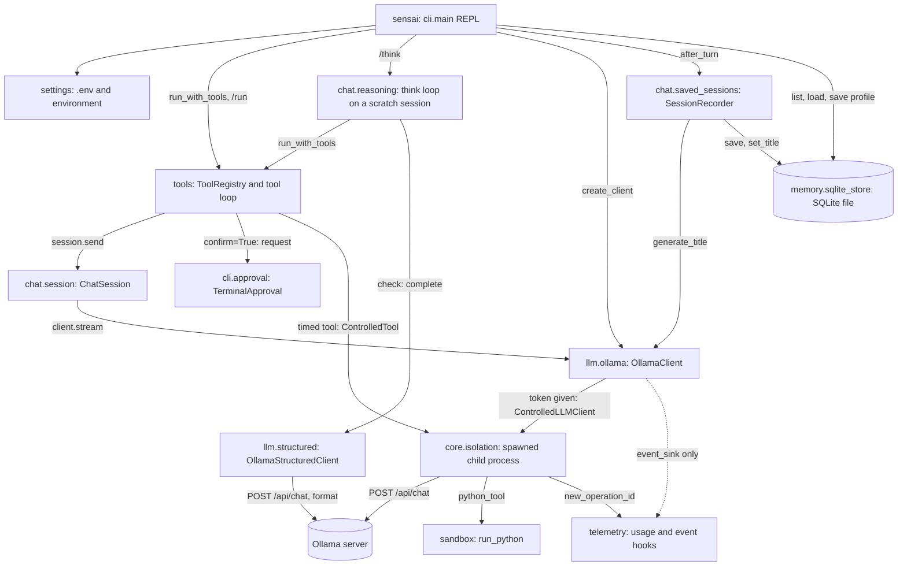
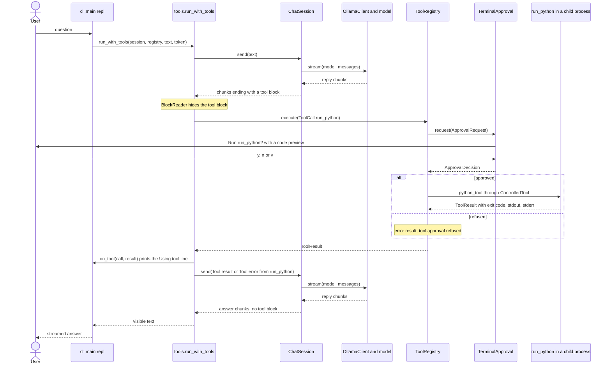

# Architecture

Sensai is one Python package, `sensai`, under `src/sensai/`. The `sensai`
command (`cli/main.py`) builds every object and wires them together; the
other modules do not know about the command line, and `sensai.core` and
`sensai.llm` never import `sensai.chat`, `sensai.cli` or `sensai.settings` at
runtime.

## Layers

| Package | Role |
| --- | --- |
| `sensai.cli` | The `sensai` command: arguments, startup checks, the chat loop (`repl`), raw terminal input, the approval prompt |
| `sensai.chat` | Conversation state: `ChatSession`, personas, system prompt, saved-session recording, the tool-block reader, the `/think` loop (`chat.reasoning`) |
| `sensai.tools`, `sensai.sandbox` | Tool registry and tool loop, `calculate`, `run_python` |
| `sensai.llm` | Ollama HTTP clients and wire format: the streaming chat client and the structured client that runs the `/think` check |
| `sensai.memory` | SQLite storage of sessions and profiles |
| `sensai.core` | Shared types: messages, errors, cancellation token, typed ports, process isolation |
| `sensai.settings` | Settings from the environment and `.env` |
| `sensai.telemetry` | Usage and event hooks; the CLI uses only its operation IDs |

This is how the modules call each other when `sensai` runs (the dotted arrow
is not used by the CLI, which sets no event sink):

## One turn

`repl()` handles commands itself; any other line starts a turn. The CLI
creates a `CancellationToken` and prints every chunk `run_with_tools()`
yields. `run_with_tools()` calls `ChatSession.send()`, which appends the user
message and streams `client.stream(model, messages)`. A `BlockReader` holds
back a final JSON block; a tool call runs through the registry and its result
goes back as the next user message, for up to five rounds. A completed turn
ends with `SessionRecorder.after_turn()`, which saves the session. Here the
model asks for `run_python`, a `confirm=True` tool, then answers with its
result:

## Cancellation and deadlines

A `CancellationToken` (`core/cancellation.py`) holds one absolute
`time.monotonic()` deadline and an optional callback. For each turn the CLI
sets the deadline to `--operation-timeout` seconds and passes
`TerminalInput.cancel_requested`, which reports a Ctrl+C or a lone Esc typed
during the reply. `raise_if_cancelled()` raises `OperationCancelled` or
`OperationTimedOut`; the CLI prints `Réponse interrompue` or
`Délai maximal dépassé`. In the main process, the session, the tool loop and
the registry check this token. Approval prompts and tools registered with
`timeout=None` pause its deadline.

A child process never gets that token. It builds a fresh one with the
deadline only and no callback (`_child()` in `core/isolation.py`). For a timed
tool, that deadline is the earlier of the tool's timeout and the question
deadline (`ToolRegistry.execute()` in `tools.py`). The parent keeps checking
the question token, and on Ctrl+C or Esc it sends SIGTERM to the child's
process group. A timed handler, `run_python` included, therefore sees the
deadline through `raise_if_cancelled()`, never Ctrl+C.

When a turn fails or is cancelled, `ChatSession.send()` and `run_with_tools()`
delete every message the turn added, tool rounds included. Only completed
turns stay in history and get saved. Text already printed stays on screen.

## Process isolation

`core/isolation.py` runs work in a fresh `spawn` child process that leads its
own session and process group. `ControlledLLMClient` runs each model request
this way (`OllamaClient.stream()` uses it whenever it gets a token, which the
CLI always passes), and `ControlledTool` runs each tool registered with a
numeric timeout. The parent checks the token and polls a socket pair at least
every 20 ms; the child sends chunks, results and typed errors as
newline-delimited JSON. To stop a child, the parent sends SIGTERM to its
group, waits 200 ms, sends SIGKILL and reaps it. Factories and handlers cross
the process boundary, so they must be importable and pickleable.

The sandbox adds its own layer: `run_python()` runs `sys.executable -I main.py`
in a new temporary folder and its own process group, with `setrlimit` limits
on CPU, memory, file size and core dumps, an almost empty environment and no
stdin. On Linux the code dies with its parent. A SIGTERM handler lets the
worker kill the code and delete the folder first, and each run removes folders
left by dead processes.

## Design choices

- We call Ollama's HTTP API directly with `requests` instead of an LLM
  framework, because the subject forbids LLM frameworks and requires direct
  Ollama HTTP calls.
- We run model requests and timed tools in a child process instead of the
  main process, because killing a process group is how Sensai interrupts
  blocked work on Ctrl+C or at the deadline.
- We commit a turn to history only when its stream completes, instead of
  keeping partial replies, so a cancelled or failed turn is never sent back as
  context or saved.
- After a persona switch, each request repeats the system message before the
  newest user message, instead of relying on the first message alone, because
  older assistant introductions must not undo the active role.
- The sandboxed code gets its own process group instead of sharing the tool
  worker's, so the sandbox's 15 s limit can kill the code without killing the
  worker or Sensai.
