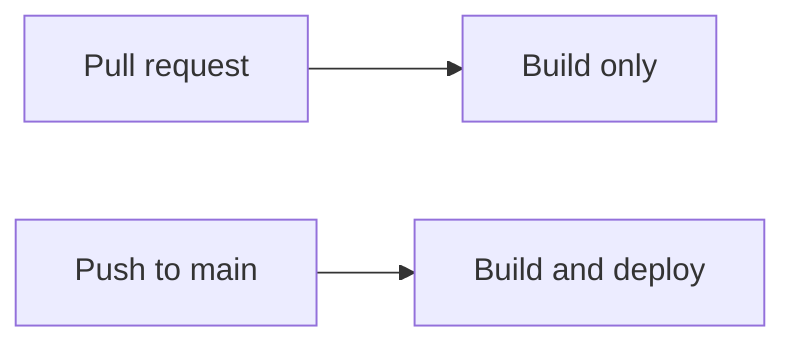

# Contributing

## Branches, commits and pull requests

- Make one branch per change, created from an up-to-date `main`, for example
  `feat/cli-history` or `docs/mkdocs-site`.
- Keep commits small and atomic, with
  [Conventional Commits](https://www.conventionalcommits.org/) messages such as
  `feat(cli): add /history` or `docs: describe the sandbox limits`.
- Open a pull request to `main`. Merging needs one approving review and a
  passing `Unit tests` check.
- Run the unit tests before pushing; see [Testing](testing.md).

## Workflows

| Workflow | File | Runs on | Does |
| --- | --- | --- | --- |
| Tests | `.github/workflows/tests.yml` | Push and pull request to `main` | Runs the offline unit tests (job `Unit tests`) |
| Documentation | `.github/workflows/docs.yml` | Push and pull request to `main`, manual run | Builds this site with `mkdocs build --strict`; deploys it from `main` only |

## Documentation

The pages under `docs/` are published with [MkDocs](https://www.mkdocs.org/)
and the Material theme at <https://omarcodes022.github.io/Sensai/>.
`mkdocs.yml` holds the site settings and the navigation (`nav`);
`requirements-docs.txt` pins the one dependency.

### Preview and check

From the repository root:

```sh
python3 -m venv .venv
.venv/bin/pip install -r requirements-docs.txt
.venv/bin/mkdocs serve           # http://127.0.0.1:8000, reloads on save
.venv/bin/mkdocs build --strict  # the same check as the workflow
```

`--strict` fails on any warning: a page missing from `nav`, a broken link or a
broken anchor. The build writes to `site/`, which git ignores.

### Add a page

1. Create the Markdown file in the folder that fits: `overview/`,
   `user-guide/` or `developer-guide/`.
2. Add it to `nav` in `mkdocs.yml`. A page that is neither in `nav` nor in
   `exclude_docs` fails the strict build.
3. Link to other pages with relative paths to their `.md` files. Link to files
   outside `docs/` with their full GitHub URL, such as
   `https://github.com/OmarCodes022/Sensai/blob/main/README.md`.
4. Preview it, then run the strict build.

Folders listed under `exclude_docs` in `mkdocs.yml` stay in the repository but
are not published; site pages must not link to them.

### Diagrams

Write diagrams in [Mermaid](https://mermaid.js.org/), in a fenced code block
whose language is `mermaid`. The site renders them, and so does GitHub:

````markdown

````

### Deployment

`.github/workflows/docs.yml` installs `requirements-docs.txt` and runs
`mkdocs build --strict`. On a pull request it only builds the site. On a push
to `main` or a manual run, it also uploads `site/` and deploys it to GitHub
Pages. Only the `OmarCodes022/Sensai` repository deploys.
