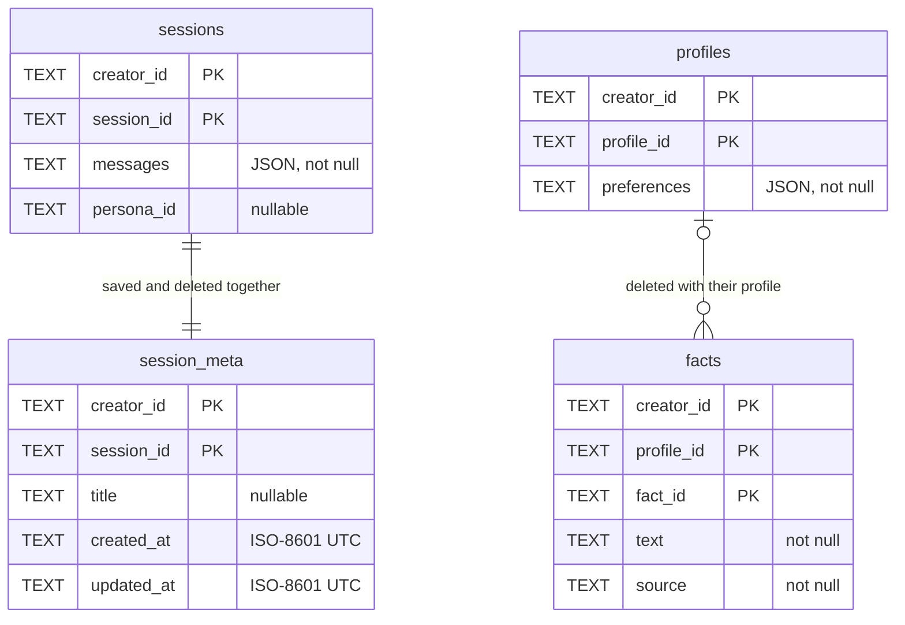

# Storage

Sensai keeps sessions and creator profiles in one SQLite file:
`sensai.sqlite3` in the current folder by default, or the path given by `--db`
or `SENSAI_DB`. `src/sensai/memory/sqlite_store.py` owns it. The schema also
has a `facts` table, not used by the CLI yet.

## Access

```python
from sensai.memory.sqlite_store import StorageRepository

with StorageRepository("sensai.sqlite3") as repository:  # opens and migrates
    creator = repository.for_creator("default")           # scopes every query
    creator.sessions.list()                               # newest first
    creator.profiles.load("default")                      # None when absent
```

`for_creator()` returns three stores: `sessions` (`load`, `save`, `delete`,
`list`, `set_title`), `profiles` (`load`, `save`, `delete`) and `facts`
(`list_for`, `upsert`, `delete`). The CLI opens the repository in
`prepare_chat()` or `list_sessions()` and closes it when the chat ends.

## Tables

| Table | Holds | Written by |
| --- | --- | --- |
| `sessions` | One row per session: its messages as JSON (user and assistant turns only) and its persona ID | `SessionRecorder`, after each completed turn and after `/persona` in a saved session |
| `session_meta` | The session's title and its creation and last-update times (ISO-8601 UTC) | The same `save()` call; the title by `set_title()` after the first save |
| `profiles` | The creator profile as a JSON object; the CLI uses profile ID `default` | `prepare_chat()`, when `--profile-file` is given |
| `facts` | Facts with their source, per profile | Nothing in the CLI |

`--list-sessions` reads `session_meta`, `--session` loads a row of `sessions`,
and every start loads the `default` profile. Every column is `TEXT` and there
are no foreign keys; the repository code keeps the links below:



## Rules

- Every query is scoped to the creator ID given to `for_creator()`. Saving an
  existing ID replaces that creator's row; loading a missing one returns
  `None`.
- IDs are non-blank strings of at most 255 characters, without control
  characters; anything else raises `InvalidStorageId`.
- Each call is atomic. `repository.transaction()` groups several calls in one
  `BEGIN IMMEDIATE` transaction and rolls it back on any error or
  cancellation. Transactions do not nest.
- A repository owns one connection: use it from one thread. Several
  repositories can open the same file.
- Errors are `InvalidStorageId`, `UnsupportedStorageSchema` and
  `StorageError`, all subclasses of `PortError`. Data is stored in plaintext.

## Migrations

`PRAGMA user_version` holds the schema version, now 3 (`SCHEMA_VERSION`).
Opening a file runs `_migrate()` in one transaction: an empty file gets all
four tables, a version 1 file gets `facts`, and version 1 and 2 files get
`session_meta` with one row per existing session (no title, both dates set to
the migration time). The migration then checks the columns and
keys of every table. Unknown versions, unversioned files that already have
tables and incompatible tables raise `UnsupportedStorageSchema`. A failed
migration leaves the file as it was. Tests live in
`tests/unit/memory/test_sqlite_store.py`.

## Design choices

- We version the schema with `PRAGMA user_version` and migrate it additively
  in one transaction, instead of recreating tables, because existing sessions,
  profiles and facts must survive an upgrade without losing rows.
- We save a session only after its first completed exchange, instead of at
  launch, so the database holds no empty sessions.
- We store only user and assistant turns and rebuild the system message on
  resume (shared prompt, then profile, then persona) instead of saving it, so
  a resumed chat always uses the current configuration.
- We ask the model for a session title in a separate request, outside the
  conversation, so the title never enters the chat history.
