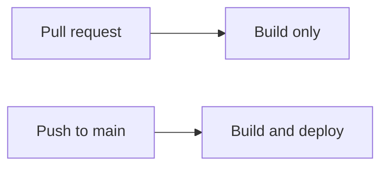

# Documentation site

The pages under `docs/` are published with [MkDocs](https://www.mkdocs.org/) and
the Material theme at <https://omarcodes022.github.io/Sensai/>. `mkdocs.yml`
holds the site settings and the `nav`; `requirements-docs.txt` pins the one
dependency.

- **Build and deploy:** `.github/workflows/docs.yml` runs on a push or pull
  request to `main` and on a manual run. It installs `requirements-docs.txt`
  and runs `mkdocs build --strict`, which fails on any warning: a page missing
  from `nav`, a broken link or a broken anchor. A pull request only builds the
  site. A push to `main` (or a manual run on `main`) also uploads `site/` and
  deploys it to GitHub Pages.
- **Mirror excluded:** the deploy job runs only when the repository is
  `OmarCodes022/Sensai`, so the Epitech mirror never publishes.

## One-time setup

A repository administrator must set **Settings → Pages → Source** to
**GitHub Actions** once. Until then the deploy job fails; the build job still
checks pull requests.

## Preview locally

From the repository root:

```sh
python3 -m venv .venv
.venv/bin/pip install -r requirements-docs.txt
.venv/bin/mkdocs serve           # http://127.0.0.1:8000, reloads on save
.venv/bin/mkdocs build --strict  # the same check as the workflow
```

The build writes to `site/`, which is gitignored.

## Diagrams

Diagrams are written in [Mermaid](https://mermaid.js.org/) inside a fenced code
block whose language is `mermaid`; the site renders them and GitHub does too:

````markdown

````
