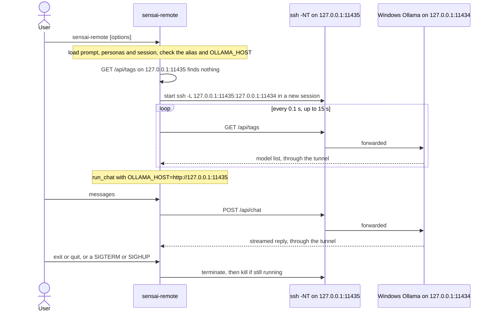

# Local or remote Ollama over SSH

Run Sensai on Linux or macOS and Ollama on the Windows GPU machine. Tailscale
and Windows OpenSSH must already allow each client to connect. Ollama stays
bound to Windows loopback; do not expose port `11434` on the network.

## Prepare each client once

Keep existing SSH keys and configuration. Create a dedicated key only if this
filename does not already exist, and choose a passphrase when prompted:

```bash
ssh-keygen -t ed25519 -f ~/.ssh/id_ed25519_sensai -C sensai
cat ~/.ssh/id_ed25519_sensai.pub
```

Copy only the `.pub` line to Windows. Never copy the private key. Each colleague
creates their own key on their own computer.

On Windows, open PowerShell as `<UTILISATEUR_WINDOWS>` (elevated if it is an administrator).
The default Windows OpenSSH configuration uses a shared administrators file
for administrator accounts, and the user's own file otherwise. Append the
public key without replacing any existing keys. **An existing file is shared
configuration:** have the Windows administrator inspect its permissions first
and confirm they are valid for the active OpenSSH configuration. For the default
administrators file, only Administrators and SYSTEM should have access; for a
user file, the owner, Administrators and SYSTEM are the permitted principals.
If the ACL is insecure or unclear, stop and ask the administrator; do not append
a key until this is resolved.

The script below inspects an existing file without changing its ACL. The
confirmation must come from the administrator, not from guessing that SSH will
accept it. If the file does not exist, its creation and initial permissions must
also be approved by the Windows owner:

```powershell
$publicKey = (Read-Host 'Paste the ssh-ed25519 public key').Trim()
if ($publicKey -notmatch '^ssh-ed25519 [A-Za-z0-9+/=]+( .*)?$') {
    throw 'Expected one Ed25519 public key line'
}
$identity = [Security.Principal.WindowsIdentity]::GetCurrent()
$isAdmin = $identity.Groups.Value -contains 'S-1-5-32-544'
$keyFile = if ($isAdmin) {
    Join-Path $env:ProgramData 'ssh\administrators_authorized_keys'
} else {
    Join-Path $env:USERPROFILE '.ssh\authorized_keys'
}
if (Test-Path $keyFile) {
    icacls $keyFile
    Get-Acl $keyFile | Format-List Owner, AccessToString
    $approved = Read-Host 'Administrator confirmed this existing ACL is valid? Type YES'
    if ($approved -cne 'YES') { throw 'Stop: administrator must validate the existing ACL' }
} else {
    $approved = Read-Host 'Windows owner approved creating this key file? Type YES'
    if ($approved -cne 'YES') { throw 'Stop: new file provisioning requires approval' }
    New-Item -ItemType Directory -Force -Path (Split-Path $keyFile) | Out-Null
    New-Item -ItemType File -Path $keyFile -ErrorAction Stop | Out-Null
    icacls $keyFile /inheritance:r
    if ($LASTEXITCODE -ne 0) { throw 'Cannot secure new key file; ask the administrator' }
    if ($isAdmin) {
        icacls $keyFile /grant:r '*S-1-5-32-544:F' '*S-1-5-18:F'
    } else {
        icacls $keyFile /grant:r "*$($identity.User.Value):F" '*S-1-5-18:F'
    }
    if ($LASTEXITCODE -ne 0) { throw 'Cannot secure new key file; ask the administrator' }
}
$existing = @(Get-Content $keyFile -ErrorAction Stop)
if ($existing -notcontains $publicKey) {
    Add-Content -Path $keyFile -Value ("`n" + $publicKey) -Encoding ascii -ErrorAction Stop
}
```

Adding another colleague's key never requires resetting a shared file's
permissions. If an existing ACL needs repair, the Windows administrator must
approve that separate operation, first back up its ACL with `icacls $keyFile
/save <backup-path>` and preserve the current keys. Do not use a routine
permissions reset as part of adding a key.

The numeric SIDs avoid depending on the Windows display language. If the server
has a custom `AuthorizedKeysFile` or `Match` block, use that configuration
instead. See [Microsoft's Windows SSH key guidance](https://learn.microsoft.com/en-us/windows-server/administration/openssh/openssh_keymanagement).

On the client, append this block to `~/.ssh/config` without replacing its
existing contents. Put it before a generic `Host *` block if that block sets
conflicting values. Do not duplicate an existing `Host sensai-windows` block:

Replace `<IP_TAILSCALE>` with the Windows PC's Tailscale IP and
`<UTILISATEUR_WINDOWS>` with its Windows account name before using this example.

```sshconfig
Host sensai-windows
    HostName <IP_TAILSCALE>
    User <UTILISATEUR_WINDOWS>
    IdentityFile ~/.ssh/id_ed25519_sensai
    IdentitiesOnly yes
```

Unlock the key in an SSH agent and make a first manual connection:

```bash
# If no desktop SSH agent is available, start one in this terminal first:
# eval "$(ssh-agent -s)"
ssh-add ~/.ssh/id_ed25519_sensai
ssh sensai-windows
```

Verify the server fingerprint with the Windows owner before accepting it. The
launcher requires a known host and never disables host-key checking. After a
client reboot, unlock the key again with `ssh-add`. The launcher uses
`BatchMode=yes` and cannot prompt for passwords or key passphrases; without an
unlocked key it fails explicitly. No password or private key belongs in `.env`.

## Select the model in .env

Edit only these entries in your existing `.env`. For a local model:

```dotenv
OLLAMA_HOST=http://127.0.0.1:11434
SENSAI_MODEL=gemma3:1b
SENSAI_SSH_HOST=
```

For the Windows model:

```dotenv
OLLAMA_HOST=http://127.0.0.1:11435
SENSAI_MODEL=qwen3.5:9b-q4_K_M
SENSAI_SSH_HOST=sensai-windows
```

Run the same command from the repository root in either mode (the
`sensai-remote` command is installed by `pip install -r requirements.txt`; rerun
it in an existing virtualenv if the command is missing):

```bash
.venv/bin/sensai-remote --persona redaction
```

All usual CLI arguments are supported, including a positional model override.
Real environment variables override `.env`, and CLI model/host arguments
override their defaults. `--help` and `--list-personas` never open a tunnel.
For a one-off local run with a remote `.env`:

```bash
SENSAI_SSH_HOST= OLLAMA_HOST=http://127.0.0.1:11434 \
  .venv/bin/sensai-remote gemma3:1b
```

The usual `.venv/bin/sensai` command still connects directly; only this launcher
manages SSH. Remote mode requires the exact loopback URL above (a trailing
slash is accepted). It never silently switches to a local model on failure.

## Server availability and tunnel lifetime

Leave Windows Tailscale in unattended mode, incoming connections permitted,
and `sshd` in automatic startup. The Windows PC must stay awake. Start Ollama
manually if needed, for example from a separate `ssh sensai-windows` session:

```cmd
curl http://127.0.0.1:11434/api/tags
ollama serve
```

Run `ollama serve` only if the first check fails because Ollama is not already
running. If started from SSH, keep that session open. Starting a second server
produces a port-already-in-use error.

The launcher binds `127.0.0.1:11435` on the client and forwards it to Windows
`127.0.0.1:11434`. It closes its own tunnel when chat exits, fails or is
interrupted, including `SIGTERM` and `SIGHUP`. It supervises a foreground SSH
child in a separate session, so cancelling a chat response does not kill the
tunnel. Shutdown first terminates that child, then kills it if needed, with
bounded waits; failures are reported. No cleanup is possible after `SIGKILL`
or a machine crash. If that local port already provides an Ollama `/api/tags`
endpoint, the launcher reuses it without checking which server it reaches,
and leaves it open afterward. Stop an old manual tunnel if you need to change
its destination. An occupied port with an invalid endpoint fails explicitly.

This is what `sensai-remote` does when `SENSAI_SSH_HOST` is set and the local
port is free:



After a client or server reboot, launch again to recreate the tunnel. There is
no background reconnection daemon: a connection dropped during chat requires
a new launch. Ollama must be started again after a Windows reboot unless
someone separately configured its automatic startup. SSH connection failures
use a ten-second connection timeout; startup is bounded to about 15 seconds
(plus at most the current two-second API probe). Authentication is
noninteractive and requires the previously unlocked SSH agent.
