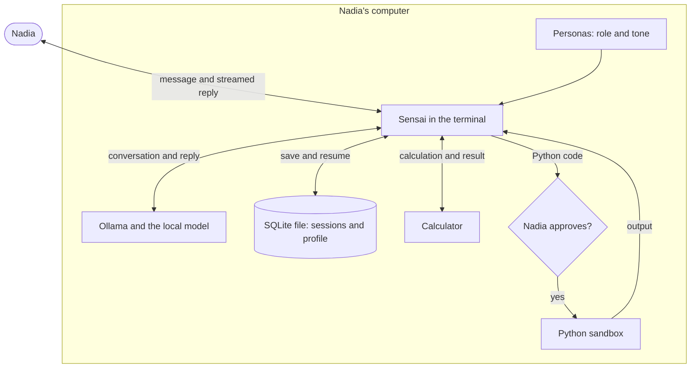

# How it works

Sensai is a program Nadia runs in her terminal. It talks to a model that
Ollama runs on her computer, and keeps her sessions in a local file.

## What happens when Nadia sends a message

1. Sensai reads her line. Its own commands, such as switching persona, run at
   once and never reach the model.
2. Otherwise Sensai sends the model the whole conversation: the instructions
   (shared rules, her profile, the active persona and the list of tools), every
   earlier exchange and her new message.
3. Ollama runs the model and streams the reply back. Sensai prints it as it
   arrives.
4. If the reply ends with a tool request, Sensai hides the request and runs the
   tool. For Python code, it first shows Nadia the code and waits for her
   answer. The result goes back to the model, which continues its answer. This
   can happen up to five times per message.
5. When the answer is complete, Sensai adds the exchange to the conversation
   and saves the session in the SQLite file. If Nadia stopped the reply or
   something failed, the exchange is dropped and not saved.

By default, Ollama runs the model on Nadia's computer and Sensai saves her
chats in a local file, so Sensai sends nothing to an online service. Python
code she approves can still use the network: see
[Tools and sandbox](../user-guide/tools.md).
